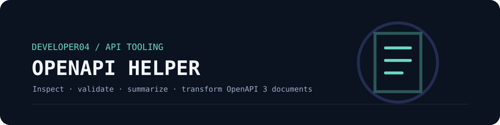

<p align="center"></p>

# d04-openapi-helper

Utilities for inspecting, validating, summarizing, and transforming OpenAPI 3.x documents.

## Features
- Enumerate operations with normalized metadata
- Generate stable operation IDs when missing
- Convert OpenAPI path parameters to colon-style router paths
- Read component schemas safely
- Produce a compact API summary
- Validate the required OpenAPI document structure

## Install
```bash
npm install
```

## Usage
```js
import { summarizeSpec, toRoutePath, validateDocument } from "d04-openapi-helper";

const spec = {
  openapi: "3.1.0",
  info: { title: "Accounts API", version: "1.0.0" },
  paths: {
    "/users/{userId}": {
      get: { summary: "Get a user", tags: ["Users"], responses: { 200: { description: "OK" } } }
    }
  }
};

console.log(validateDocument(spec));
console.log(toRoutePath("/users/{userId}"));
console.log(summarizeSpec(spec));
```

## API
| Export | Purpose |
| --- | --- |
| `listOperations(spec)` | Return normalized operations |
| `operationId(method, path)` | Generate an operation identifier |
| `toRoutePath(path)` | Convert path template parameters |
| `findSchema(spec, name)` | Retrieve a component schema |
| `summarizeSpec(spec)` | Return API metadata and operations |
| `validateDocument(spec)` | Check required OpenAPI fields |

## Development
```bash
npm test
```

## License
MIT
